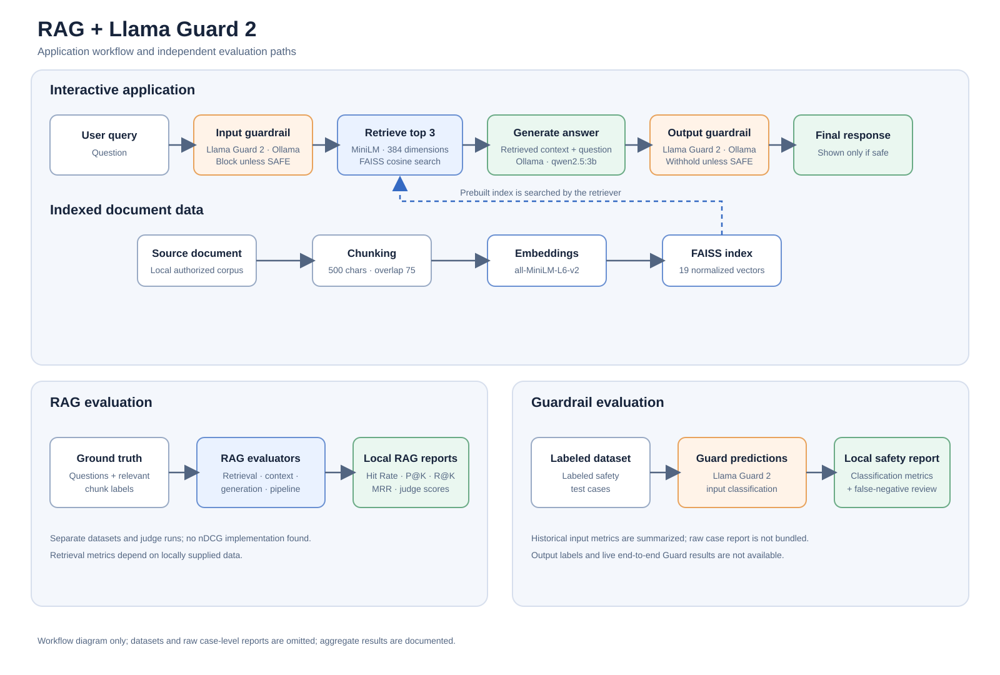

# RAG and Llama Guard 2 Evaluation Lab

A RAG application and evaluation codebase with local Ollama inference, Llama
Guard 2 input/output checks, and separate evaluation workflows for retrieval,
generated answers, and safety classification.

This project contains the application source, tests, and documentation. The
public branch intentionally omits the original source corpus, evaluation
datasets, corpus-derived artifacts, model checkpoints, and raw historical
result reports. Historical RAG and Llama Guard input metrics are summarized
below and in the final evaluation report; they are not results from a new run.

## 1. Project overview

The RAG application embeds document chunks with Sentence Transformers,
retrieves similar chunks from a FAISS index, and asks an Ollama-hosted model to
answer using that context. Llama Guard 2 checks user input before retrieval
and the generated answer before it is shown.

The codebase includes separate retrieval, embedding, context-assembly,
answer-quality, end-to-end pipeline, and Llama Guard evaluation workflows.
Evaluation datasets and raw historical reports are not bundled in this public
branch.

## 2. Problem statement

RAG can ground answers in a supplied corpus, but retrieval can miss evidence and
generation can be incomplete or unsupported. Retrieval and answer-quality
metrics do not measure whether prompts or generated text are unsafe. This
project explores those concerns as separate engineering and evaluation tasks.

## 3. Project objectives

- Preserve a working, locally runnable RAG workflow.
- Evaluate retrieval relevance and embedding behavior against labeled examples.
- Inspect context handoff and generated-answer quality.
- Apply input and output safety checks with a local Llama Guard 2 model.
- Report the guardrail's observed classifications, errors, and limitations.
- Keep RAG judge-provider configurations explicit and reproducible.

### Current layout

Application code, utilities, evaluation scripts, and tests are organized as
Python packages. Run modules from the project root:

```text
rag_evals/
├── .env.example, .gitignore, README.md, requirements.txt
├── src/
│   ├── rag/                   # RAG chat and FAISS retrieval
│   ├── guardrails/            # Llama Guard input/output checks
│   └── evaluation/            # RAG and safety evaluators
├── scripts/                   # chuck_document.py, embedding and index builders
├── tests/                     # Offline unit tests and opt-in live integrations
├── data/                      # Local corpus and generated artifacts
├── datasets/                  # Local evaluation datasets
├── docs/                      # Architecture and evaluation methodology
├── models/                    # Model references; weights are local
└── reports/                   # Sanitized aggregate report; raw reports are ignored
```

In the public branch, `data/` and `datasets/goldens/` contain explanatory
README files only; evaluation datasets and raw generated reports are excluded.
The reviewed aggregate
[final evaluation report](reports/final_rag_evaluation_report.md) is the
allow-listed report. See [data requirements](data/README.md) before running
the application.

## 4. Architecture diagram



See the [architecture notes and editable Mermaid source](docs/architecture.md)
for component details. See the [implementation guide](docs/implementation.md)
for data flow and commands, and the
[publication checklist](docs/publication_checklist.md) for unresolved dataset
and model redistribution checks.

## 5. RAG pipeline and implementation

The application workflow is:

1. `scripts/chuck_document.py` reads a locally supplied, authorized text corpus
   and uses LangChain's `RecursiveCharacterTextSplitter` with a 500-character
   target, 75-character configured overlap, and paragraph/sentence/space
   separators. The corpus and generated artifacts are not included here.
2. `scripts/generate_embeddings.py` encodes those chunks with
   `sentence-transformers/all-MiniLM-L6-v2`; the implementation uses
   384-dimensional vectors.
3. `scripts/build_faiss_index.py` L2-normalizes vectors and builds a FAISS
   `IndexFlatIP` index. Inner product over normalized vectors is cosine
   similarity.
4. `src/rag/rag_chat.py` embeds a question with the same model, retrieves the top 3
   chunks, and formats their IDs and text into the prompt.
5. Ollama serves `qwen2.5:3b` at `http://localhost:11434/api/chat`. The system
   prompt instructs the model to rely on retrieved context, avoid unsupported
   claims, and explicitly say when the context is insufficient.

`src/rag/retrieve.py` is a separate interactive retrieval utility whose default is
top-5; the chat application uses `TOP_K = 3`. The application currently expects
the original index layout and vector count. See
[RAG evaluation notes](docs/rag_evaluation.md) for the corresponding experiment
methodology and the data needed to run it.

## 6. Evaluation methodology

The evaluation modules keep retrieval, embedding, context handoff, answer
quality, end-to-end behavior, and guardrail classification as separate
experiments:

- Retrieval reports Hit Rate, Precision, Recall, and MRR at configured K values.
  Unanswerable questions without relevant chunk labels are not included in
  retrieval aggregates.
- Embedding checks validate vectors and compare labeled similarity/ranking
  behavior.
- Context evaluation checks that retrieved evidence reaches the generation
  request; it does not judge answer quality.
- Generation and pipeline evaluation use a configured external LLM judge for
  correctness, faithfulness, and relevance. Runs with different providers or
  datasets are not controlled comparisons.

The source-derived evaluation datasets and raw historical reports are not
included in this public branch. The results below are transcribed from existing
local reports; they are historical measurements, not new runs. Their small
datasets and differing judge providers limit comparisons. See
[RAG evaluation notes](docs/rag_evaluation.md) for denominators and metric
definitions, and the [final evaluation report](reports/final_rag_evaluation_report.md)
for the complete component summary.

### Historical RAG results

| Evaluation | Dataset / denominator | Recorded result |
|---|---:|---|
| Embeddings | 10 questions; 19 chunks | 384 dimensions; vectors finite; relevant-vs-unrelated pairwise accuracy **0.9964**; mean similarity **0.6474** vs **0.2634**; average query embedding latency **15.20 ms** |
| Retrieval | 5 answerable questions; 1 unanswerable excluded | At k=1: Hit Rate **0.800**, Recall **0.600**, Precision **0.800**, MRR **0.800**. At k=3: Hit Rate **1.000**, Recall **1.000**, Precision **0.4667**, MRR **0.8667**. At k=5: Hit Rate **1.000**, Recall **1.000**, Precision **0.2800**, MRR **0.8667**; average retrieval latency **30.30 ms** |
| Context handoff | 5 questions | All chunks reached the generator; **0** empty, duplicate, or omitted cases; maximum context **1,370 characters** |
| Generation | 6 records | Correctness **0.825**, faithfulness **0.975**, relevance **0.950**; average generation latency **17.53 s**; prior OpenRouter judge run |
| RAG pipeline | 6 records; retrieval aggregates use 5 answerable cases | Retrieval at k=3: Hit Rate **1.000**, Precision **0.4667**, Recall **1.000**, MRR **0.8667**. Answer scores: correctness **0.8667**, faithfulness **0.9333**, relevance **0.9500**; average end-to-end latency **15.70 s**, judge latency **24.69 s**; Aion judge run |

Generation and pipeline figures come from different judge runs (OpenRouter and
Aion respectively), so they are not a controlled provider comparison.

## 7. Llama Guard 2 safety checks

`src/rag/rag_chat.py` uses the integration in `src/guardrails/llama_guard.py`
to call the local Ollama model
`hf.co/QuantFactory/Meta-Llama-Guard-2-8B-GGUF:Q4_K_M`.
The code does not fine-tune this model.

- **Input:** checks the user query before retrieval. An unsafe, malformed,
  empty, unexpected, or failed guard response blocks processing.
- **Output:** checks the generated answer before displaying it. A blocked answer
  is not returned to the user.
- **Failure behavior:** guard request errors and unrecognized classifications
  fail closed (the query or answer is blocked). The interactive app prints
  safety-block reasons and operational errors.

The `Q4_K_M` model tag identifies a GGUF quantization variant using roughly
4-bit weight quantization, which can lower memory requirements compared with
higher-precision weights, with possible quality/performance trade-offs. Ollama
must be running locally and the model must be available to it.

The historical input evaluation scored 60 labeled cases (35 unsafe, 25 safe):
accuracy **96.67%**, unsafe precision **100%**, recall **94.29%**, F1 **97.06%**,
with **33 true positives, 0 false positives, 25 true negatives, and 2 false
negatives**. Average classification latency was **4.19 s**. This is a
historical input-only result, not a result for output classification or live
guarded RAG.

`src/evaluation/evaluate_llama_guard.py` evaluates labeled input cases;
`src/evaluation/evaluate_llama_guard_output.py` evaluates separately labeled
assistant outputs. The output dataset is not present. The
`src/evaluation/evaluate_llama_guard_e2e.py` script runs the guarded RAG flow
on the labeled input cases and reports input metrics and enforcement outcomes;
it cannot calculate output classification metrics without labels for generated
answers. No live end-to-end Guard evaluation report exists yet. See the
[Guard evaluation notes](docs/guardrail_evaluation.md) for schemas, report
paths, test coverage, and limitations.

## 8. Installation and configuration

The existing environment used Python 3.13.5. From PowerShell in the project
directory, create an environment and install the pinned direct dependencies:

```powershell
py -3.13 -m venv .venv
.\.venv\Scripts\Activate.ps1
python -m pip install --upgrade pip
python -m pip install -r requirements.txt
```

Install [Ollama](https://ollama.com/) separately, start it, and pull the
application models:

```powershell
ollama pull qwen2.5:3b
ollama pull "hf.co/QuantFactory/Meta-Llama-Guard-2-8B-GGUF:Q4_K_M"
```

The model names above match the current code. The judge-based generation and
pipeline evaluators also need credentials for the selected provider. Copy
`.env.example` to `.env` and fill only the provider settings you intend to use.
Never publish `.env` or its credentials. The example lists OpenRouter, Gemini,
and Aion-compatible configurations.

`src/evaluation/evaluate_generation.py` loads `.env` with `override=True`, so values in that
file take precedence over process-level environment variables for that script.

## 9. Running the application

With Ollama running and both models pulled:

```powershell
python -m src.rag.rag_chat
```

Type a question at the prompt; type `exit` to leave. This public branch does
not include the corpus, chunks, embeddings, index, or metadata. The
application will not run until you supply an authorized corpus and prepare the
required local artifacts described in [data requirements](data/README.md).

To rebuild the data artifacts, run the utilities from the project root. These
commands create or replace generated files under `data/`:

```powershell
python -m scripts.chuck_document
python -m scripts.generate_embeddings
python -m scripts.build_faiss_index
```

## 10. Running evaluations

The evaluation modules require evaluation datasets and, depending on the
workflow, a local model and/or external judge credentials. Source-derived
evaluation datasets and historical reports are not included in this branch.
Only run evaluations after supplying data you have permission to use. Running
an evaluator may call models and incur provider costs. Guard evaluator report
writers refuse to overwrite existing files; check the behavior of other
evaluation scripts before rerunning them.

Example commands, after supplying the required local inputs:

```powershell
# Embedding diagnostics and retrieval compatibility
python -m src.evaluation.evaluate_embeddings

# Retrieval metrics at K=1, 3, and 5
python -m src.evaluation.evaluate_retrieval

# Verify retrieved-context handoff into the generator prompt
python -m src.evaluation.evaluate_context

# Generation-quality evaluation (Ollama + configured judge provider)
python -m src.evaluation.evaluate_generation

# End-to-end RAG evaluation (Ollama + configured judge provider)
python -m src.evaluation.evaluate_pipeline

# Llama Guard input-classification evaluation (Ollama)
python -m src.evaluation.evaluate_llama_guard

# Llama Guard output-classification evaluation (requires a separate labeled dataset)
python -m src.evaluation.evaluate_llama_guard_output

# Full guarded RAG evaluation (requires local corpus/index/model setup)
python -m src.evaluation.evaluate_llama_guard_e2e
```

These scripts write reports under `reports/`; raw reports are ignored by Git.
The sanitized aggregate report is allow-listed. Raw historical result reports
are not included in this public branch; selected results are summarized above
and in the [final evaluation report](reports/final_rag_evaluation_report.md).

Candidate generation in `src/evaluation/golden_dataset_builder.py` uses the
local Ollama model and requires the authorized source document and chunks. It
saves candidates for human review; no candidates become evaluation goldens
until explicitly approved. Review
`datasets/goldens/rag_golden_candidates.jsonl`, mark only approved records
with `"review_status": "approved"`, and run:

```powershell
python -m src.evaluation.golden_dataset_builder --build-reviewed
```

The builder refuses to replace existing golden files. Use
`--overwrite-goldens` only after backing them up.

Run the offline unit-test modules that do not call live model services with:

```powershell
python -m unittest tests.test_evaluate_context tests.test_evaluate_embeddings tests.test_evaluate_generation tests.test_evaluate_pipeline tests.test_evaluate_retrieval tests.test_golden_dataset_builder tests.test_llama_guard tests.test_evaluate_llama_guard
```

The standalone `test_model.py` and `test_openrouter_auth.py` make live model/API
requests and are not included in that offline command.

## 11. Dependencies and model requirements

`requirements.txt` pins the direct Python dependencies observed in the existing
Python 3.13.5 environment. This is not a lockfile, and a clean installation
from it has not been verified. Ollama and its model files are external to pip.
The source corpus, generated FAISS artifacts, evaluation datasets, and
historical reports are not included in this branch.

## 12. Security, data, and publication notes

- Keep `.env` local. `.gitignore` excludes it; publish only the placeholder
  `.env.example`, and never paste credentials into source or reports.
- Datasets and source documents are omitted pending provenance and
  redistribution review.
- Raw historical report files and model checkpoints are not included. The
  reviewed aggregate report contains selected historical metrics; no
  evaluation results were rerun or altered while preparing this documentation.
- No project `LICENSE` is included. Select one only after confirming the right
  to license the code and all included materials.
- Review [the publication checklist](docs/publication_checklist.md) and each
  upstream model's license before redistribution or use.

## 13. Known limitations

- The clone does not include a source corpus, generated index, or the RAG and
  guardrail evaluation datasets. The application and most evaluators therefore
  need authorized local inputs before they can run.
- The stored FAISS loader/index builder expects the original vector count;
  changing the source document or chunking may require reviewing that
  implementation assumption.
- Precision@K divides by requested K, even when fewer results could be
  returned; the current index has enough vectors for the reported K values.
- LLM-as-judge scores can vary by provider/model and are not human ground truth.
- Historical Llama Guard metrics cover input classification only. Output
  classification lacks a separate human-labeled dataset, and live end-to-end
  Guard evaluation results have not been recorded.

## 14. Future improvements

- Expand independently reviewed retrieval, generation, and guardrail datasets.
- Create and review a separate output-labeled dataset, then evaluate output
  false positives and false negatives.
- Run and document the end-to-end Guard evaluation only after the required
  local datasets, RAG artifacts, and model services are available.
- Re-run judge comparisons with identical data and explicitly recorded configs.
- Add relevance-label audits and nDCG only if desired and correctly specified.
- Make fixed vector-count expectations derive from validated artifacts.
- Export the architecture SVG to a raster format for platforms that require PNG.
- Add independently reviewed datasets and reports only after their provenance
  and redistribution rights are documented.

## 15. Research reference and acknowledgements

- [Llama Guard: LLM-based Input-Output Safeguard for Human-AI Conversations](https://arxiv.org/abs/2312.06674)
- The Llama Guard 2 model is accessed through Ollama; it was not fine-tuned as
  part of this project.
- Thanks to the maintainers of Sentence Transformers, FAISS, LangChain, Ollama,
  and the evaluation tools used in these experiments.