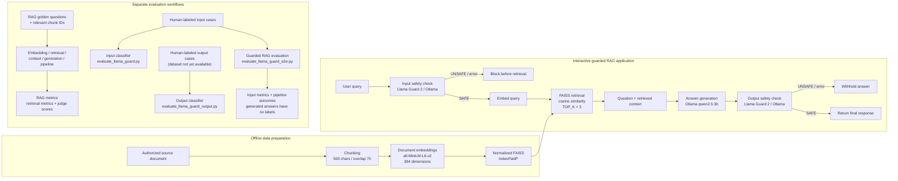

# Architecture

The application flow below reflects the implementation in
`src/rag/rag_chat.py` and `src/guardrails/llama_guard.py`. It uses
`sentence-transformers/all-MiniLM-L6-v2`, a normalized FAISS index, Ollama
`qwen2.5:3b`, and the local Ollama Llama Guard 2 Q4_K_M model.

## Application workflow

1. `scripts/chuck_document.py` chunks an authorized local source document.
2. `scripts/generate_embeddings.py` embeds chunks with MiniLM; the vectors are
   384-dimensional.
3. `scripts/build_faiss_index.py` normalizes vectors and builds a FAISS
   `IndexFlatIP` index. Inner product over normalized vectors is cosine
   similarity.
4. `src/rag/rag_chat.py` calls Llama Guard on the user query. Unsafe or failed
   checks block the request before embedding and retrieval.
5. A safe query is embedded and the top three chunks are retrieved and
   formatted with the question as generation context.
6. Ollama generates an answer with `qwen2.5:3b`. The prompt instructs the model
   to ground factual claims in the retrieved context and abstain if evidence is
   insufficient.
7. Llama Guard checks the generated answer before it can be returned. Unsafe
   or failed output checks withhold it.

Input and output checks use distinct role-specific instructions. Llama Guard
responses other than a recognized `safe` result are handled fail-closed.
The model is used through Ollama; it was not fine-tuned in this project.

## Evaluation architecture

RAG retrieval, embedding, context-handoff, answer-quality, and pipeline
evaluations are separate from Guard classification. Existing RAG reports
record small historical experiments; their actual metrics and denominators
are summarized in the [RAG evaluation notes](rag_evaluation.md) and
[final report](../reports/final_rag_evaluation_report.md).

The historical labeled Guard report measures **input classification only**.
The input evaluator uses labeled queries, the output evaluator requires a
separate human-labeled assistant-response dataset, and the end-to-end Guard
evaluator uses labeled input queries to exercise the guarded RAG path. The
end-to-end evaluator records pipeline enforcement outcomes but cannot score
generated-answer classification without human labels for those answers.

## Data and artifacts

- The source corpus, generated chunks, embeddings, FAISS index, and metadata
  are local inputs and are not included in the public branch.
- Evaluation datasets and raw historical reports are not included in the
  public branch. Selected historical metrics are documented; they are not new
  results.
- See the [data requirements](../data/README.md) and
  [publication checklist](publication_checklist.md) before adding local or
  third-party content.
